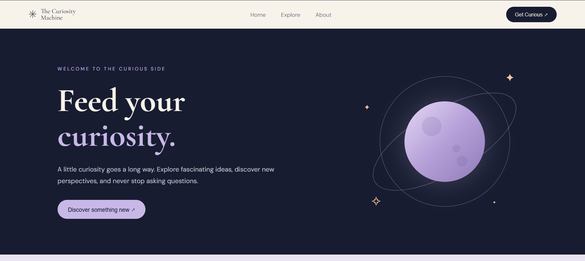

# ✳ The Curiosity Machine

**A little curiosity goes a long way.**

The Curiosity Machine is an interactive, responsive website designed to encourage exploration and make learning fun. It brings together interesting questions from different fields and turns everyday curiosity into an opportunity to discover something new.

🌐 **Live Demo:** https://curiosity-machine-nine.vercel.app/

## 👀 Preview



## ✨ Features

- **Explore Categories:** Discover questions across Science, Creativity, Psychology, and Life & Mindset.
- **Interactive Category Modals:** Browse questions in a popup and reveal their answers and interesting facts.
- **Daily Curiosity:** Explore a new question, reveal its answer, and move to another question.
- **Responsive Design:** Adapted for desktop, tablet, and mobile screens.
- **Interactive Navigation:** Navigate between sections with a responsive menu.

## 🛠️ Built With

- React
- JavaScript
- CSS3
- Vite
- Lucide React

## 🚀 Getting Started

To run the project locally:

**1. Clone the repository**

```bash
git clone https://github.com/Rahaf-jaber/curiosity-machine.git
```

**2. Navigate to the project folder**

```bash
cd curiosity-machine
```

**3. Install dependencies**

```bash
npm install
```

**4. Start the development server**

```bash
npm run dev
```

Open the local URL displayed in your terminal to explore the website.

## 📁 Project Structure

```text
curiosity-machine/
├── public/
├── src/
│   ├── assets/
│   ├── components/
│   │   ├── About.jsx
│   │   ├── CategoryCard.jsx
│   │   ├── DailyCuriosity.jsx
│   │   ├── Explore.jsx
│   │   ├── Footer.jsx
│   │   ├── Hero.jsx
│   │   └── Navbar.jsx
│   ├── App.jsx
│   ├── App.css
│   ├── index.css
│   └── main.jsx
├── index.html
└── package.json
```

## 💡 About the Project

The Curiosity Machine was built as a frontend development project to practice React, component-based architecture, state management, and responsive web design.

The idea is simple: follow a question, discover something interesting, and keep learning.

---

**Made with curiosity!**
